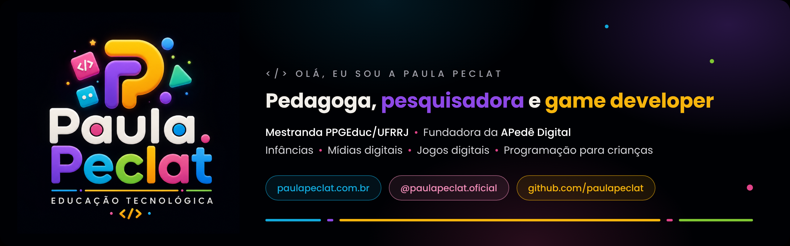
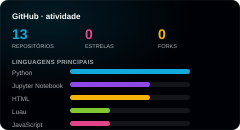
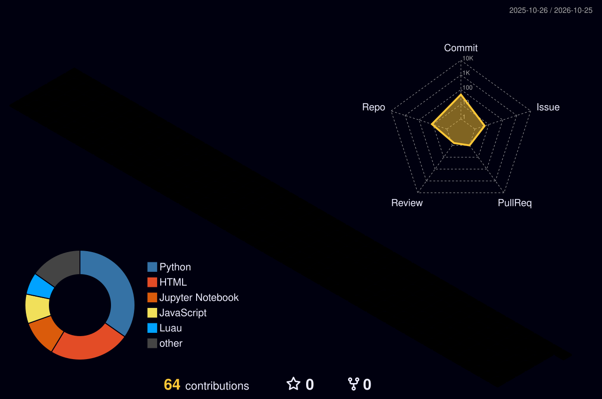

<a href="https://paulapeclat.com.br"><strong>→ paulapeclat.com.br</strong></a> ·
<a href="https://instagram.com/paulapeclat.oficial"><strong>@paulapeclat.oficial</strong></a>

  

<a href="README.md">🇧🇷 Português</a> · 🇺🇸 **English**

 

### 🔭 What I do

**Research** — Master's in Education (PPGEduc/UFRRJ, Brazil), advised by Prof. Dr. Anelise Monteiro do Nascimento. I work at the intersection of **media education**, **media literacy**, childhoods and technology: I study digital childhoods through the lens of the Sociology of Childhood (Corsaro, Sarmento), treating children as producers of culture — not passive media consumers.

**Teaching** — Founder of [APedê Digital](https://paulapeclat.com.br), a technology education platform for children, with students from all 27 Brazilian states and abroad. Curriculum in Python, Roblox/Luau, GDevelop and microStudio, progressing from concrete to abstract.

**Projects** — Tools that bridge research and practice: educational scripts, classroom simulators, game data analysis.

 

### 🧠 Research interests

 

### 🎮 The Trail

 

### 📌 Now

<!--STATUS-START-->
🟢 Finishing my master's qualifying exam
<!--STATUS-END-->

 

### ✨ Media education resources of the day, from Brazil to the world

<!--RECURSO-START-->
🇧🇷 **Brazil** · [Marco Civil da Internet — Lei 12.965/2014](https://www.planalto.gov.br/ccivil_03/_ato2011-2014/2014/lei/l12965.htm): Princípios, garantias e deveres para o uso da internet no Brasil. (PT)

🌍 **World** · [Currículo de Alfabetização Midiática e Informacional para Professores (UNESCO)](https://unesdoc.unesco.org): Documento de referência da UNESCO para formação docente em AMI/MIL. (PT)
<!--RECURSO-END-->

every day, one Brazilian and one international resource from my curated list <a href="https://github.com/paulapeclat/awesome-educacao-midiatica">awesome-educacao-midiatica</a> ⭐

 

### 🗺️ Reach Map

 

### 📊 Teacher Dashboard

  

 

### 🛠️ Tools & technologies

**Game and app creation — concrete to abstract, in the order I teach**

**Languages & code**

**AI & automation**

**Media & communication**

 

### 🌆 Contributions in 3D

 

### 📚 Methodology

- **Child-centered** — I listen, observe and build from children's own curiosities
- **Practice-reflective** — Theory informing practice; practice generating new data
- **Progressive** — From concrete to abstract, from playful to formal
- **Collaborative** — An open space for building together

 

### 💼 Open to collaboration

I'm open to:
- **Research** in media education, media literacy, digital childhoods, technology education, educational game design
- **Teaching** through workshops, courses and project mentoring
- **Development** of educational tools and pedagogical simulators
- **Consulting** on education policy for the digital context

 

### 📫 Contact & links

---

<a href="README.md">🇧🇷 versão em português</a>

