<a href="https://paulapeclat.com.br"><strong>paulapeclat.com.br</strong></a> ·
<a href="https://instagram.com/paulapeclat.oficial"><strong>@paulapeclat.oficial</strong></a>

  

🇧🇷 **Português** · <a href="README.en.md">🇺🇸 English</a>

 

Oi! Eu sou a Paula, mas na sala de aula todo mundo me chama de **Profe Paula** 👋

Sou pedagoga, pesquisadora e game developer. Passo os dias entre crianças criando jogos, artigos sobre infâncias e scripts que eu mesma uso nas aulas. Este perfil é meio caderno de campo, meio fliperama. Fique à vontade pra mexer em tudo.

 

### 🔭 O que eu faço

**Pesquisa.** Faço mestrado em Educação no PPGEduc/UFRRJ, com orientação da Profª Drª Anelise Monteiro do Nascimento. Estudo como as crianças vivem o digital juntas, com os amigos, a partir da Sociologia da Infância (Corsaro, Sarmento). Parto de uma ideia simples que guia tudo o que faço: criança produz cultura, não só consome tela.

**Ensino.** Ensino crianças a programar e criar jogos pela [Educação Tecnológica Paula Peclat](https://paulapeclat.com.br), que acabou de sair da fase de validação e agora começa a crescer. Já tive alunos dos 27 estados do Brasil e de fora do país. A gente começa no concreto e vai chegando ao abstrato, passando por GDevelop, microStudio, Roblox/Luau e Python.

**APedê Digital.** É o produto novo em que estou colocando tudo o que aprendi nesses anos de sala de aula. Está na reta final de desenvolvimento, e logo conto mais por aqui.

**Projetos.** Gosto de construir as ferramentas que me faltam. Aqui tem script de aula, simulador de sala e análise de dados de jogos, quase sempre nascidos de uma pergunta que surgiu com a turma.

 

### 🧠 Temas de interesse

 

### 🎮 A Trilha

 
cada conquista nova vira uma linha em <code>data/trilha.json</code> e a trilha se redesenha sozinha

 

### 📌 Agora

<!--STATUS-START-->
🟢 Finalizando a qualificação do mestrado
<!--STATUS-END-->

essa linha se atualiza sozinha via `scripts/update_status.py`

 

### ✨ Recurso do dia em educação midiática

<!--RECURSO-START-->
🎯 **[EU Kids Online](https://www.lse.ac.uk/media-and-communications/research/research-projects/eu-kids-online)**: rede europeia de pesquisa sobre crianças e internet.
<!--RECURSO-END-->

todo dia sorteio um recurso da minha lista <a href="https://github.com/paulapeclat/awesome-educacao-midiatica">awesome-educacao-midiatica</a> ⭐

 

### 🗺️ Mapa de Alcance

 
todo lugar de onde já veio aluno meu, desenhado a partir de <code>data/alcance.json</code> com coordenadas reais

 

### 📊 Painel da Profe

 
inspirado nos Learning Analytics Dashboards, gerado a partir de <code>data/painel.json</code>
  

 

### 🛠️ Ferramentas & tecnologias

**Criação de jogos e apps, na ordem em que eu ensino**

**Linguagens e código**

**IA e automação**

**Mídia e comunicação**

 

### 🌆 Contribuições em 3D

 

### 📚 Como eu trabalho

- **Começo pela criança.** Escuto, observo e monto a aula a partir do que ela tem curiosidade de saber.
- **Teoria e prática andam juntas.** A pesquisa muda minha aula, e a aula me devolve perguntas novas pra pesquisa.
- **Um passo de cada vez.** Do concreto ao abstrato, da brincadeira ao código.
- **Ninguém cria sozinho.** A sala é um espaço de construção coletiva, e eu também aprendo com a turma.

 

### 💼 Bora fazer algo juntos?

Adoro uma parceria! Se você pensa em algum destes caminhos, me chama:
- **Pesquisa** sobre educação midiática, infâncias digitais e game design educacional
- **Oficinas, cursos e mentorias** pra crianças ou pra educadores
- **Ferramentas educacionais** e simuladores pedagógicos
- **Consultoria** em políticas educacionais para o contexto digital

 

### 📫 Contato & redes

---

feito com carinho, código e muitos robôzinhos. Veja os <a href="https://github.com/paulapeclat/paulapeclat/tree/main/scripts">scripts</a> e <a href="https://github.com/paulapeclat/paulapeclat/tree/main/.github/workflows">workflows</a> · <a href="README.en.md">🇺🇸 English version</a>

